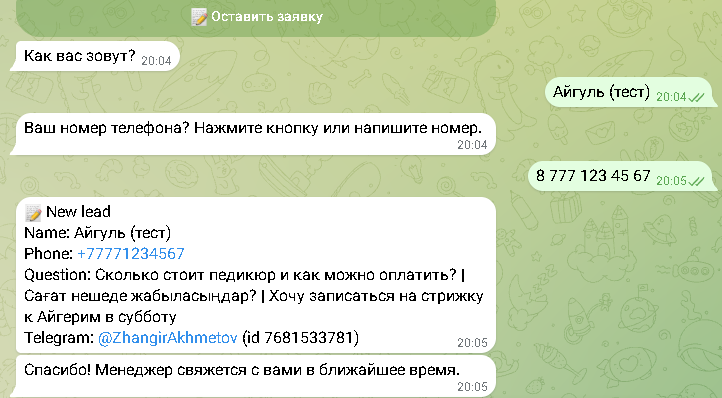

# AI FAQ bot for Telegram

[](https://github.com/zhangir777/ai-faq-bot/actions/workflows/ci.yml)

A Telegram bot that answers customer questions 24/7 using your company's FAQ, then collects
leads (name + phone) into Excel and sends them to managers.

- Answers **only from your knowledge base** (`knowledge.md`): no made-up prices or services.
  If the answer isn't there, it says so and offers to leave a request.
- Understands and replies in **Russian, Kazakh and English**.
- Lead capture: name → phone (button or typed, normalized to `+7…`) → saved to `data/leads.xlsx`
  with the customer's questions, and sent to managers in Telegram. Managers get the file with `/leads`.
- Runs on **free LLM APIs**: Groq (main model + fallback model), optional Google Gemini as a backup.
  If one provider is down or hits its limit, the next one answers.
- Per-user limit (30 questions/hour) to protect the free quota; short chat memory for follow-up questions.

| Answers (RU / KZ) | Lead capture |
|---|---|
|  |  |

## Set up for a new client (10 minutes)
1. Replace `knowledge.md` with the client's info: services, prices, address, hours, payment, rules.
   Plain text or Markdown, no special format.
2. Change the greeting and button texts in `TEXTS` in `bot/main.py`.
3. Copy `.env.example` to `.env` and fill in `BOT_TOKEN`, `ADMIN_IDS`, `GROQ_API_KEY`.

## Run
```bash
uv sync
uv run python -m bot.main
```
or with Docker:
```bash
docker compose up -d --build
```

## Tests
```bash
uv run pytest -q
```
Offline tests (no Telegram, no LLM): answer → lead → Excel → manager notification through the real
dispatcher with a fake Telegram API, provider fallback against a local fake API, rate limit, `/leads`.

## Stack
Python 3.12, aiogram 3, aiohttp, openpyxl, Groq / Gemini (OpenAI-compatible API).

## License
MIT
